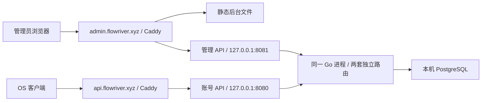

# FlowRiver 管理后台契约与运行边界

日期：2026-10-01。状态：管理后台和邮箱-only 账号 API 已部署；Apple 登录关闭，账号删除/身份解绑保持 fail-closed。

## 文档职责（2026-10-04）

本文保留为当前管理员界面/权限/API参考，不再独立安排一条重构路线。未完成建设与恢复统一由[账号与恢复方案](../../主规划.md)T17推进；范围是单管理员账号服务，日记正文/坐标/同步密钥不进入管理台。

已有查询、撤销、TOTP、密码重置、激活批次及前端优化按实现与交付记录使用。旧“待实现接口”“部署前无SMTP/VPS”等描述不再当现状；真正异机日志接收/读取重放、恢复演练和能力开放仍须证据。仅login_only模式无需异机接收端也可运行登录，但删除/解绑必须fail-closed。手工登记恢复结果不算自动恢复已验证。

## 1. 产品定位

为 FlowRiver OS 的维护者提供账号服务管理入口：了解运行状况、查询用户和设备、定位发信问题、追踪安全操作及备份状态。首期按一个管理员设计，多人协作后再扩展权限。

拟定地址：`https://admin.flowriver.xyz`。账号 API 继续使用 `https://api.flowriver.xyz`。管理员页面服务于产品维护，用户的首次注册登录由 iOS/macOS 完成。

后台管理范围与现有服务器一致：账号、登录身份、设备、会话和运维状态。页面不提供用户日记、位置、AI 对话或同步密钥查询。

## 2. 两种布局

| 方案 | 页面组织 | 适合场景 |
|---|---|---|
| 管理工作台（首期建议） | 左侧固定导航，右侧列表与详情，总览突出待办 | 每天查询用户、排查登录问题、处理设备请求 |
| 值守视图 | 顶部导航，总览优先展示依赖状态与异常队列 | 偶尔查看服务器，快速判断是否有事项需要处理 |

两种布局共用数据、权限与页面能力。对话中的预览支持切换方案、切换页面、搜索示例用户、查看设备和模拟撤销确认。全部数字及账号记录均为演示；实时状态未接入时显示“未接入”，不补成正常或零。

## 3. 页面与信息架构

| 导航 | 第一屏内容 | 主要操作 | 首期范围 |
|---|---|---|---|
| 总览 | 待处理事项、账号及会话数量、依赖状态 | 跳到具体问题 | 查询 |
| 用户 | 账号列表、邮箱/ID 查询、状态筛选 | 展开用户详情 | 查询 |
| 设备与会话 | 设备、所属账号、会话状态、最近活动 | 查看账号；重新验证后撤销服务登录 | 查询与受控撤销 |
| 登录与邮件 | 发信队列、尝试次数、错误类别、验证码过期状态 | 查看失败原因 | 查询 |
| 安全与审计 | 删除/身份撤销队列、Apple 通知、管理员操作记录 | 追踪状态及请求 ID | 查询 |
| 运行与备份 | API/DB 状态、资源占用、备份与恢复验收 | 查看记录及排查方向 | 查询 |
| 设置 | 管理入口、管理员验证、配置就绪情况、协议版本 | 管理员自身安全设置 | 查询与自身安全设置 |

### 总览

按“需要处理什么 → 服务是否可用 → 最近账号变化”排序。首期只展示可定义、可取数的指标：

- 当前存在的账号数量，明确是否包含删除处理中和需要恢复的账号。
- 当前可用会话数：会话未过期且未撤销，所属用户与设备也允许访问。
- 待处理安全变更数和最长等待时间，便于发现积压。
- 最近成功备份、校验结果与恢复演练，分别展示。

不把累计账号数量称为累计注册量；物理删除后当前数量会下降。若以后需要注册趋势，另建去标识化的按日汇总。首期不绘制没有采集来源的趋势图、实时在线人数或发送成功率。

### 用户与设备详情

列表默认显示脱敏邮箱、随机用户 ID、登录方式、账号状态、设备数量及注册时间。查询支持完整邮箱的精确查找及完整用户 ID；不能对所有邮箱开放任意模糊枚举。预览中搜索发生在本地示例数据，正式服务另设精确查询规则。

详情显示：

- 用户 ID、注册时间、当前状态。
- 邮箱和 Apple 身份分别展示，不因相同邮箱暗示已经合并。
- 当前同意的条款/隐私版本及时间。
- 设备平台、显示名称、服务端最近活动时间。
- 每个设备的可用会话、撤销时间与相关安全事件。

当前数据库没有用户昵称、头像、付费订阅字段，首期不把它们设计成可编辑资料。设备最近活动取自账号服务请求，不能解释为实时在线状态。

### 登录与邮件

分清“待发送”“正在发送”“待重试”“已交给 SMTP”“已过期”“最终失败”。现有邮件任务的 `completed_at` 与 `last_error_code` 必须一起判断：任务完成可能表示失败后终止，不能一律显示发送成功。

供应商没有反馈收件状态时，显示“已交给 SMTP”，不显示“已送达收件箱”。显示错误类别、次数、下次重试时间和请求 ID，不显示验证码、邮件正文、SMTP 凭据或 outbox 加密载荷。

首期不增加任意邮箱群发、批量重发或“查看验证码”入口。

### 安全与审计

删除、身份移除及 Apple 授权撤回按照真实队列状态展示：已请求 → 等待异机回执 → 本地变更完成 → Apple 后续撤销状态。供应商撤销失败与本产品账号数据清理分别说明；状态未知时不显示已完成。

操作记录包括操作者、权限、对象、动作、原因、时间、请求 ID 和结果。当前 `audit_events` 只有业务用户/事件/请求字段，不能直接充当完整的管理员审计，需要扩展独立记录。

用户自行申请删除后，管理员可以跟踪进度；首期不提供跳过安全日志的强制删除按钮，也不允许修改用户的登录身份归属。

### 运行与备份

分别显示：

1. API 存活、数据库就绪；现有健康接口可支持这两项。
2. 邮件、Apple、安全日志的配置情况和最近验证结果；不能从 API readiness 推断。
3. CPU、内存、磁盘：需要新增低频采集，未采集时显示未知。
4. 备份任务退出状态、远端对象、密文校验时间、最近恢复演练。

备份计划为每小时运行、远端保留 7 天；安全日志覆盖 30 天。计划值和远端实际验证结果分开。当前备份脚本没有结构化管理记录，需增加受限的状态输出/采集；页面不能自行假定任务成功。

恢复入口首期展示演练记录与操作说明。实际数据库恢复仍通过受控运维流程执行，不能用网页中的“一键恢复”直接覆盖生产库。

## 4. 视觉规则

风格：清晰、安静、偏工具型，低饱和绿色用于选中项；琥珀色表示需要处理，红色表示失败或不可访问。所有状态同时给出文字。

| 项目 | 规则 |
|---|---|
| 字体 | 系统中文字体；正文 14px、表格 13px、辅助标签 12px，页面标题 25–28px，ID 使用等宽字体 |
| 布局 | 左侧导航约 178–220px，主区域留白 20–36px |
| 表格 | 紧凑行、水平分隔、端点分页；操作栏尽量少 |
| 详情 | 宽屏列表右侧独立查看身份和设备；窄屏在列表下方展开并滚动定位，保留列表及查询条件 |
| 弹窗 | 仅用于确认敏感操作和登录验证；支持取消、Escape 与键盘焦点约束 |
| 颜色 | 明暗外观适配；浅色绿色约 `#226749`，深色适配更亮的绿色 |
| 手机 | 导航单行横向滑动，内容上下排列；必要的表格在自身容器内横向滚动 |
| 时间 | 存储 UTC；后台显示明确的时区，默认 UTC+8，不混用“服务器本地时间” |

不通过大面积装饰、渐变或无来源的图表占据第一屏。所有未知/空白/失败/加载状态均有文字解释。

2026-10-03 界面优化已发布到 `https://admin.flowriver.xyz`：统一刷新入口及 UTC+8 读取时间，刷新时保留既有记录，首次请求失败不显示为空列表；用户详情独立加载和重试，页面切换取消旧请求；设备和邮件支持对已加载记录筛选，审计支持读取更早记录；兑换批次创建表单默认折叠，尚未下载的完整兑换码离开/刷新前提示。API、管理页和新 JS/CSS 均已核验返回 HTTP 200。验收记录见 [前端优化验收](../changes/admin/FLOWRIVER_ADMIN_UI_OPTIMIZATION_2026-10-03.md)。

## 5. 核心操作流程

### 查询账号

用户列表 → 输入完整邮箱或 ID → 结果 → 账号详情 → 身份、设备和安全记录。没有结果时显示未找到，查询错误时显示错误与重试，不能把查询失败当成零条记录。

完整邮箱仅在有权限的详情查询中揭示，并审计该访问；默认列表脱敏。浏览器不缓存账号响应，退出后清空内存中的详情。

### 撤销设备登录

账号详情 → 选择设备 → 展示影响 → 填写原因 → 管理员近期二次验证 → 提交唯一请求 ID → 后端事务撤销全部相关服务会话并写审计 → 回读实际状态。

页面明确说明：该操作只撤销账号服务登录，不能远程清除用户日记或收回旧 iCloud 同步密钥。请求超时先查询操作结果；不能先显示成功再等待后端。

### 排查删除积压

总览待办 → 安全事件详情 → 查看日志回执/Apple 队列状态 → 按错误类别检查对应依赖。管理员不能手动勾选“已完成”覆盖工作任务状态。

## 6. 管理权限与登录

首期一个独立管理员：由 SSH 上的初始化命令创建，不开放公网管理员注册；普通 FlowRiver 用户登录不能赋予管理员权限。生产 API 要求明确配置 `ADMIN_ALLOWED_IPS` IP/CIDR allowlist；这由服务端核对 Caddy 覆盖写入的客户端地址，并在配置缺失时拒绝生产启动。所有管理接口在服务端逐请求授权，隐藏按钮不构成权限检查。[OWASP 授权设计](https://cheatsheetseries.owasp.org/cheatsheets/Authorization_Cheat_Sheet.html)

首期采用管理员账号/密码加 TOTP 二次验证；之后可加 Passkey。密码只保存专用密码散列，TOTP 秘密独立加密保存。恢复代码一次性展示并保存散列；恢复流程需要受控 SSH 验证，不通过普通用户邮箱自行提升权限。

- 管理员身份、会话和业务用户会话分开存储，服务端保存不透明管理会话的摘要。
- 浏览器使用仅绑定管理主机的 `__Host-` Cookie，设置 `Secure`、`HttpOnly`、`SameSite=Strict`、`Path=/`，不设置父域 `Domain`；不将管理令牌放入 localStorage。[Cookie 属性](https://developer.mozilla.org/en-US/docs/Web/HTTP/Reference/Headers/Set-Cookie)
- 写操作验证 CSRF token 和来源；SameSite 不能替代完整的 CSRF 防护。[OWASP CSRF 防护](https://cheatsheetseries.owasp.org/cheatsheets/Cross-Site_Request_Forgery_Prevention_Cheat_Sheet.html)
- 会话初始闲置期限 15 分钟、最长 8 小时；敏感操作要求 5 分钟内完成二次验证。这些是拟定管理策略，需实现后测试。
- 首期限制管理入口来源 IP 或私有网络访问，同时保留应用认证。
- 日志不记录密码、TOTP、Cookie、验证码、Apple 令牌或邮件加密载荷。操作原因使用有限类别和短备注。

首期一名管理员使用 SSH 一次性初始化，无网页注册或用户权限提升。当前没有多管理员邀请/角色修改界面。

## 7. 与现有后端衔接

现有 `/v1/me`、设备撤销和删除接口针对当前业务用户，不能当全局管理员 API 使用。后台需要新管理端路由及独立认证。

### 新接口草案

以下为管理员接口契约参考，已有实现以OpenAPI和源码为准；表中早期草案不作为待实现任务。管理端同源使用 `/admin-api/v1`，由 Caddy 转发到本机管理监听端口。

| 接口 | 用途 |
|---|---|
| `POST /admin-api/v1/auth/login` | 校验密码，返回短期二次验证挑战，不直接授予管理会话 |
| `POST /admin-api/v1/auth/mfa` | 完成二次验证，设置管理 Cookie |
| `POST /admin-api/v1/auth/logout` | 撤销管理会话 |
| `GET /admin-api/v1/overview` | 已定义的账号/会话数量、待办和数据更新时间 |
| `GET /admin-api/v1/users` | 状态筛选、精确邮箱/ID 查询、游标分页 |
| `GET /admin-api/v1/users/{id}` | 身份、设备、同意版本和相关安全状态 |
| `GET /admin-api/v1/devices` | 服务设备及会话列表 |
| `GET /admin-api/v1/mail-jobs` | 发信队列元数据，不返回内容或验证码 |
| `GET /admin-api/v1/security-events` | 安全事件队列与处理状态 |
| `GET /admin-api/v1/audit` | 管理员操作记录 |
| `GET /admin-api/v1/operations` | 资源、备份校验和演练状态，每项带采集时间 |
| `GET /admin-api/v1/config-status` | 缺失/已配置/未验证，不返回密钥值 |
| `POST /admin-api/v1/devices/{id}/revoke` | 当前已实现：二次验证、原因、幂等请求、事务撤销及管理员审计 |

列表默认 25 条，最多 100 条，稳定游标按时间和 ID 分页。数据权限、查询限制和结果脱敏在后端执行；前端不直接连接数据库。

复用业务服务中的会话撤销逻辑，通过显式的管理员授权调用；不冒充用户、不绕过事务。新增管理员表、管理员会话表、二次验证挑战及完整管理员审计。权限检查与业务写入必须绑定同一请求，重试不重复操作。

## 8. 2 核 2 GB 的部署方式

建议使用 Vue 3 + TypeScript + Vite 开发静态后台，在 Mac/CI 编译，把产物交给 Caddy。VPS 上不常驻 Node，也不运行 Vite 开发/预览服务器。[Vue 项目构建](https://vuejs.org/guide/quick-start.html)、[Vite 静态部署](https://vite.dev/guide/static-deploy.html)

拟定部署拓扑：

两个监听地址共用现有 Go 进程和受限数据库池，管理端由显式功能开关启用。生产管理端口仅回环监听；管理页面与管理 API 同源，不开放跨域凭据访问。新增 Cookie/身份检查由管理端执行，不能只依赖 Caddy 路径。

初始预算：

- 静态页面首屏资源压缩后目标小于 300 KB，使用系统字体、本地打包图标，按页面加载。
- 总览最多每 60 秒刷新一次，页面不可见时暂停；列表只在用户查询、翻页或主动刷新时请求。
- 汇总最多缓存 60 秒；撤销结果、用户详情和认证不使用会造成权限滞后的缓存。
- 管理查询初始超时 2 秒，最多两个查询并发，并使用索引和分页；沿用最多 5 个数据库连接的总预算。
- 操作记录保留窗口先按现有业务审计的 30 天设计，延长期限前核对磁盘、隐私和恢复需要。
- CPU/内存采集每 60 秒写一份无敏感信息的结构化状态，独立受限采集器不能授予网页通用 shell 或 sudo 能力。

这些是实现预算，需要实测，不能视为已经达到。

## 9. 验收与当前边界

异机安全事件读取/重放与隔离恢复统一由根目录主规划T17安排。当前保留单管理员，不在本轮扩展多管理员；邮件接收回执须有真实供应商证据才能显示最终送达状态。

### 关键验收

- 未登录和普通业务用户访问管理 API 均被拒绝；修改对象 ID 也不能绕过授权。
- 登录限流、TOTP 重放/失败限制、CSRF、管理员登出及过期会话按设计生效。
- 列表、用户详情和日志没有验证码、密钥、令牌、日记内容泄漏。
- 空列表、查询失败、加载中、数据陈旧、外部服务未知分别可辨识。
- 撤销接口失败或超时不会显示成功，重复请求不重复写入，审计与结果可对应。
- 查询不会拖慢业务登录；前端压缩体积及 Go 内存通过这台 VPS 的实际测量。
- 手机布局可操作，确认对话框支持键盘，深色外观文字与状态可读。

## 10. 本次交付与下一步

现已接入 Go API 与静态管理台，支持 TOTP 管理员登录、TOTP 重放拒绝、来源 IP/CIDR 限制、密码轮换、用户详情、设备/会话撤销、幂等请求、限速、逐次审计、邮件队列、安全事件、Linux 资源和备份状态。静态 Vue/Vite 文件打入 Go 二进制；同一服务使用独立回环端口 `127.0.0.1:8081`，由 `admin.flowriver.xyz` 的 Caddy 站点代理。

安装包构建命令为 `make -C server release-linux`，生成 Linux amd64 与 arm64 压缩包。后台已经读取真实数据库状态；管理员输入的恢复演练结果只是人工登记，不代表服务已经自动还原或重放安全变更。

VPS/DNS/SMTP与客户端登录入口已有交付记录，当前状态须另验。真正异机HTTPS日志接收、恢复读取重放工具及演练由T17补齐；仅登录模式可运行，但删除/身份解绑在缺依赖时保持fail-closed。两端账号生命周期与资料迁移/隔离按T02–T04推进。操作步骤见 [落地教程](../operations/FLOWRIVER_SERVER_DEPLOYMENT_TUTORIAL.md)，管理员接口见 [OpenAPI](../../server/api/admin-openapi.yaml)，服务构建要求见 [server/README.md](../../server/README.md)。
