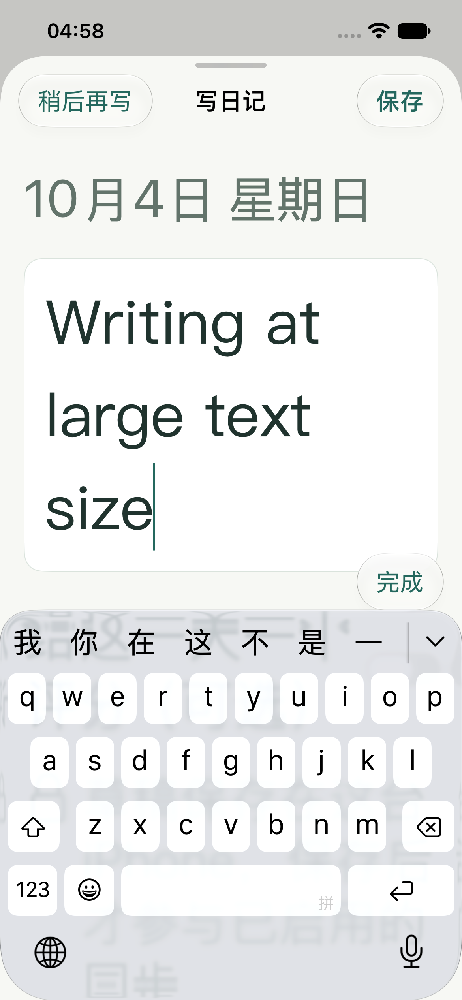
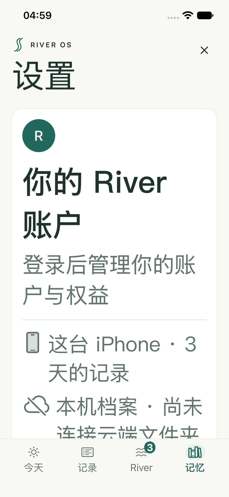

> 历史证据：这是2026-10-04四入口实现的截图审查，当前五页基线和开发验收见 [主规划](../../../主规划.md)。保留历史结果，不作为当前设计规范。

# River Diary · iOS 视觉审查

日期：2026-10-04  
范围：现有截图的只读审查，结合当前 SwiftUI 实现核对信息层级与交互尺寸。  
状态：**DONE_WITH_CONCERNS**。正常字号核心页面已形成一致的个人记忆 OS 体验，所查看截图未发现阻断核心任务的严重视觉缺陷；仍有触控和最大字号的局部优化项。

本报告沿用 `ios-design-review` 技能的 10 个审查维度，使用本轮已导出的截图，不启动设备控制或新增测试。分数是主观设计判断，不能替代功能测试、无障碍验收或云端同步验收。完整 UI 套件及 Release 构建由主线程执行，本报告不声明其最终结果。

## 证据范围

截图名称、设备和导出文件来自以下 manifest：

- `/tmp/river-system-verified-screens/manifest.json`：iPhone 17e 模拟器的正常字号页面与最大辅助字号页面。
- `/tmp/river-system-device-screens/manifest.json`：真机 iPhone 14 Pro的今天、事实详情与登录页。真机截图不等于已验证真实登录网络请求或云端同步。

以下截图已实际打开检查；链接已保存为仓库内的截图证据。

| 页面 | 截图与状态 | 视觉判断 |
| --- | --- | --- |
| 今天 | [正常字号](<手机端UI设计图/02-个人记忆OS-2026-10-04/Modern · clear_life · today--1e978174.png>)、[真机](<手机端UI设计图/02-个人记忆OS-2026-10-04/River OS · Today with saved facts and no analysis--599a3aba.png>) | 品牌、日期、自己的文字、继续写与已保存事实建立了明确顺序。首屏可以看见事实，AI 不再占据主要工作区域。8.8/10。 |
| River | [正常字号](<手机端UI设计图/02-个人记忆OS-2026-10-04/Modern · clear_life · river--61d212cb.png>) | 所选日期、活动/日记数量、本机检索、资料范围、待核对理解都可读。固定输入区域提供连续对话入口。8.5/10。 |
| 记忆 | [正常字号](<手机端UI设计图/02-个人记忆OS-2026-10-04/Modern · clear_life · archive--671b2ccd.png>) | 搜索与类别先于档案，日记日期、正文摘要与收藏标记清楚。开放列表与输入/状态卡片之间有区别。8.7/10。 |
| 设置 | [正常字号](<手机端UI设计图/02-个人记忆OS-2026-10-04/Modern · clear_life · settings--d750f8ec.png>) | 账户身份、本机记录与尚未连接云端文件夹同时说明；没有把 QA 视觉会话写成已登录或已同步。功能分组清楚。8.5/10。 |
| 登录 | [邮箱登录](<手机端UI设计图/02-个人记忆OS-2026-10-04/River OS · River OS email login--e285926e.png>)、[真机邮箱](<手机端UI设计图/02-个人记忆OS-2026-10-04/River OS · River OS email login--5d85528a.png>)、[真机密码](<手机端UI设计图/02-个人记忆OS-2026-10-04/River OS · River OS password login--257f4110.png>) | 品牌承诺与已登录后的页面属于同一系统；两种身份验证入口明确。密码模式内容更长，需要滚动到提交按钮。8.6/10。 |
| 最大字号记忆 | [最大辅助字号](<手机端UI设计图/02-个人记忆OS-2026-10-04/River OS · me at largest accessibility text--2a07ba2b.png>) | 日记条目已从日期边栏与正文并排改成纵向阅读，正文没有被挤进窄栏；较长内容可继续纵向滚动。类别栏仍需横向滚动。8.0/10，限于截图可见范围。 |
| 补充状态 | [无位置记录](<手机端UI设计图/02-个人记忆OS-2026-10-04/River OS · Map without fabricated locations--b1d299bd.png>)、[当日搜索无匹配且键盘打开](<手机端UI设计图/02-个人记忆OS-2026-10-04/River OS · Record search with no matching facts--72681379.png>)、[最大字号设置](<手机端UI设计图/02-个人记忆OS-2026-10-04/River OS · System settings at largest accessibility text--1b74f0d5.png>) | 无位置记录说明真实缺失、权限状态与开启入口，不绘制假路线。最大字号账户卡片与搜索键盘状态仍有下述局部阅读成本。 |

## 10 个设计维度

| 维度 | 主观分数 | 已看到或核对的证据 | 达到 10 分仍需什么 |
| --- | --- | --- | --- |
| 1. 字体层级 | 8.5/10 | 正常字号页面中，品牌署名、大标题、章节、正文与来源有稳定层级；正文以阅读为主。最大字号记忆已重排。 | 最新最大字号账户卡片已采用纵向身份布局，说明与邮箱可完整展开；需继续覆盖很长的邮箱与账号名。 |
| 2. 间距节奏 | 8.5/10 | 截图各页左右边界一致；代码中主要边距为 20pt、章节间隔为 24pt。底部导航没有压住固定 River 输入区域。 | 对长文、键盘、系统权限弹窗等组合状态继续核对间距；不能仅凭首屏证明所有安全区域场景。 |
| 3. 颜色层级 | 8.5/10 | 河水绿用于主要动作，正文墨色与次级文字分明。按当前清透生活色值计算，正文/画布约 12.51:1，次级正文/画布约 4.64:1，白字/主按钮约 6.53:1。 | 继续审计提示文字、禁用状态、错误/警告及全部深色组合。上述计算只支持这些基础色对，没有证明全部控件均通过对比度检查。 |
| 4. 点击目标 | 8.5/10 | 主写作按钮、日期箭头、设置图标、底部导航在截图中明显可点；代码大多数入口提供至少 44pt 高度。 | 审查发现的记忆类别按钮最小宽度已补至 44pt；仍应以设备元素边界核对所有交互区域。 |
| 5. 加载、空态与错误 | 8.0/10 | 无位置记录明确解释“已保存的位置才会显示”，并提供开启入口；代码提供数据库失败重试、写作失败消息与草稿保留。 | 补充真实网络延迟、失败、数据库不可用和权限拒绝的实际状态截图。本次静态材料没有覆盖所有异步过程。 |
| 6. 无障碍 | 7.5/10，有限证据 | 最大字号记忆的纵向重排、减少装饰说明与可滚动正文有实际截图支持；代码包含入口标签、选择状态及部分 Reduce Motion 分支。 | 运行 VoiceOver 的顺序、朗读、焦点恢复和自定义底栏验证；验证色觉差异与减少动态效果。不能据此称“无障碍已全部完成”。 |
| 7. 动效纪律 | 未评分 | 静态截图无法评价动效。代码的通用轻动效为 0.22 秒，反馈组件有 Reduce Motion 处理。 | 观察切页、键盘、反馈消失、地图定位与减弱动态效果开启后的实际过程，才能对流畅度与同时动效数量评分。 |
| 8. iOS 交互习惯 | 8.5/10 | 页面使用原生导航、系统表单控件和写作 sheet。一级四栏语义稳定，正文详情与返回入口明确；真机截图能适应实际顶部安全区域。 | 继续验证边缘返回、sheet 下拉关闭、键盘收起与外接键盘。自定义底栏的系统辅助功能行为仍须实际测试。 |
| 9. 信息密度 | 8.0/10 | 正常字号今天可同时阅读自己的文字与真实事实；记忆的搜索和分类前置；River 把范围状态与对话动作分开。 | 最大字号类别栏仍横向滚动；记录搜索键盘打开时，无匹配结果区域位于下方，需要继续滚动或收键盘。可使当前类别和搜索结果反馈更容易发现。 |
| 10. 品牌与模板感 | 9.0/10 | 双线河流标记、River OS 署名、暖白/墨色/河水绿、中文阅读层级贯穿登录与工作空间，没有无意义的大渐变、装饰仪表或占位海报。 | 用更长、更复杂的真实资料继续检验同一排版，不靠统一卡片解决所有内容类型；本轮 QA 示例文案不能视为正式用户内容。 |

基础对比度来自 `RiverThemeStore.swift` 中的明确色值计算，而非截图像素抽样。夜色仪表的正文/画布约 14.37:1、次级正文/画布约 8.42:1；本报告没有将它等同于深色界面的完整视觉验收。

## 主要结论与局部关注点

今天、River、记忆、设置与登录已经有一致的产品身份。旗舰感主要来自明确的空间职责和可信的状态语言：自己的文字与已发生事实优先，River 的理解有资料范围与确认入口，账户身份和云端档案状态分别说明。所查看的正常字号截图中没有出现核心标题互相覆盖、主要动作消失或假云端成功状态。

审查提出的记忆类别按钮最小宽度已补足；最大字号设置账户卡片已改为纵向身份布局，并由最新截图核对。最大字号记忆的主要正文重排已得到截图与 `AnyLayout(VStackLayout(...))` 实现的共同支持；类别栏的右缘裁切来自横向滚动，仍可进一步改善发现性。

主线程已导出并打开最大字号写作专项截图，保存和重新打开经过专项验证。截图同时促成了聚焦输入时收起大日期与说明的进一步改进，以给正文和键盘留出空间；最新专项测试与截图确认短文正文和光标位于键盘上方。

最新大字号输入与账户截图：

## 尚未验证

- VoiceOver 实际朗读、焦点顺序与跨 sheet 的焦点恢复。
- 减少动态效果、色觉差异、外接键盘与完整辅助字号组合。
- 真实邮箱收码、密码登录请求、恢复密码服务与联网 AI 回答。
- 真机位置/健康权限的全部状态，以及后台系统行为。
- 真实云端档案连接、跨设备加密复制、冲突与核对完成状态。
- 本轮完整 UI 套件和 Release 构建的最终结果；以主线程保存的实际运行结果为准。

## 关键截图

正常字号今天：

最大辅助字号记忆：

