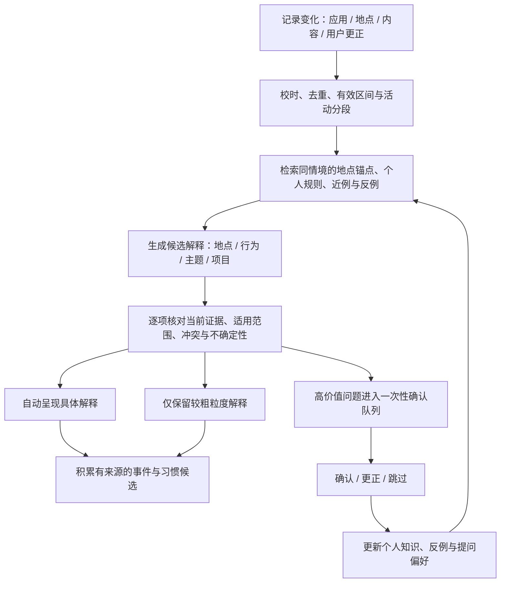

# 河流日记：个人情境理解与持续学习方案

日期：2026-09-27  
状态：分阶段实施中；下方实现进展描述当前 macOS 代码，未实现项仍是后续提案。  
适用范围：macOS 自动记录、时间线、地点、个人记忆和习惯分析。  
设计承接：`docs/MAC_TIMELINE_LIST_UI_REDESIGN_2026-09-26.md` 的自动整理方向；本方案进一步引入跨天个人知识和学习反馈。

> 实现进展（2026-09-27）：macOS 已接通全天 AI 时间线理解（保留全天活动片段，窗口标题、Chrome 页面标题和位置名称由独立开关授权发送，并保留证据引用），AI 可对单次重要但未理解的时间片生成自然语言澄清并进入「需要你确认」；跨天习惯由独立的「习惯回顾」页面承接，基于最近 14 个完整本地日的 AI 时间线摘要生成个性化交流，快捷回复由模型按情境生成且始终提供自由输入。用户与模型的往返保存在回顾卡中；用户明确确认的自然语言习惯写入个人规则并进入后续模型上下文，可撤销。两个页面共用证据与 AI 分析，但单次标注不会自动成为长期习惯。早期第 10.2/10.4 节里的固定选项问卷和范围编辑器已由本次产品方向取代；下面相关章节按实际实现更新。
>
> AI 分析互通（2026-09-27）：日报和习惯回顾共享 `ContextAssembler`、`AnalysisRun` 与证据白名单；习惯对话的原文和 AI 回答随习惯卡保存在加密 V2 库中，确认的规则在后续分析中以自然语言上下文提供。Chrome 页面标题、窗口标题和反向地理编码地点名称各有独立 AI 发送开关，默认关闭；不发送完整 URL 或坐标。完整网页语义、用户确认地点锚点、课程/项目实体识别、跨日机会分母与漂移评估仍未实现；模型不得把应用名或访问记录单独当作用户意图。

## 1. 产品目标

用户正常生活和使用电脑，河流日记持续把零散信号理解为「在哪里、在做什么、围绕什么主题、属于哪个项目」，并逐渐发现稳定习惯。刚开始只询问少量能重复使用的信息；熟悉的情境自动完成，不再逐条请求确认。

目标体验：

- 最初告诉应用「这里是宿舍」「这个位置是图书馆」「我用 Codex 做这个项目时算工作」。以后同样情境无需重复解释。
- 宿舍的可靠停留记录、持续的 Codex 活动和已经学到的开发工作模式，可以生成「在宿舍进行开发工作」。
- 图书馆的可靠停留记录、前台课程页面和持续的英语四级内容，可以生成「在图书馆学习英语四级」。
- 进入新地点、换了学习目标或出现与旧模式矛盾的内容时，系统会调整判断，只在有必要且值得时问一个具体问题。

生活感来自对真实情境的理解、恰当的叙述和连贯的记忆。用户可以补写，但不需要靠写日记维持系统的理解能力。

## 2. 对现有实现的判断

| 已有基础 | 当前作用 | 需要补齐 |
| --- | --- | --- |
| `LocationSourceStore.swift`、`RawEvent.locationUpdate` | 记录坐标、精度、时间；当前请求约百米级定位，距离过滤为 100 米 | 有名字且可复用的地点锚点、停留区间、样本新鲜度、歧义区域判断 |
| `TimelineAnnotation` | 给单条记录写地点、活动和标题 | 区分「仅本次」与「以后同类情境」；把后者变成有范围的个人规则 |
| `ActivitySession`、窗口标题采样、`ChromeHistoryReader` | 应用前台区间、窗口标题、Chrome 访问历史 | 同时段的活动标签页、课程实体、可选的播放状态；历史访问本身不能证明观看 |
| `Episode`、`MemoryKind.habit`、`MemoryLibrary` | 时间段、习惯记忆类型、记忆确认与来源关联 | 从独立事件发现习惯、反例统计、规则晋升、衰减和撤销机制 |
| `organizeTimeline`、`TimelineDigest` | 生成当天的候选分组、概览和摘要 | 输入中还需加入地点情境、个人规则和历史近例；指纹需覆盖知识版本 |
| `TimelineAIDigestView` | 缺少标题或人工标注时显示保守描述 | 改为根据本次证据和已学习的规则判断；没有新标题也可以识别熟悉活动 |
| `ActivityConfidenceEngine` | 衡量记录量和来源一致性 | 不能直接当作「在宿舍工作」这句话正确的概率，需要独立的逐项判断 |

本次源码检查显示，地点主要仍作为原始事件或人工文字，尚未进入时间线个人情境推断；`MemoryKind.habit` 是现成类型，但没有形成从确认到规则再到自动应用的完整学习流程。

## 3. 路线选择

| 路线 | 做法 | 成本与主要取舍 |
| --- | --- | --- |
| A：在提示词里加入历史记录 | 最小改动，在当天请求里附加过去的标注 | 小；适合验证文案，但容易遗忘、重复询问，难以解释规则作用范围和撤销影响 |
| **B：本机个人知识 + 情境推断 + 有选择地询问** | 保存地点、主题、个人规则与反例；模型理解内容，本机管理证据、决策和反馈 | 中到大；推荐。可逐阶段接入现有事实库，能追溯为什么越来越少问 |
| C：立即训练个人专属模型 | 累积数据并微调行为分类模型 | 大；初期可靠标签不足、用户差异和漂移难处理，不作为第一阶段依赖 |

推荐 B。初期“越来越懂用户”主要通过个人记忆检索、规则适配、近例判断和校准完成，不需要先训练大模型。积累足够可靠反馈以后，再评估小型分类器是否值得加入。

推荐方向由本方案提出；“继续”表示继续完成设计，不代表已启动实现或已批准所有参数。

## 4. 分开理解四件事，再组合成一句话

每个时间段保存四个独立判断：

| 维度 | 示例 | 主要依据 |
| --- | --- | --- |
| 地点 | 宿舍、图书馆、图书馆附近、未知 | 已确认地点锚点 + 同时段的位置样本 + 精度与停留 |
| 行为 | 编程、学习、阅读、娱乐、沟通 | 前台/参与状态、内容语义、工具组合、个人规则 |
| 主题 | 英语四级、操作系统、河流日记 | 课程/文档/页面标题、授权的内容摘要、主题别名 |
| 目的或项目 | 开发工作、课程作业、个人兴趣、某项目 | 用户确认过的分类习惯、项目实体、当前上下文 |

Codex 可以用于工作、课程作业或兴趣编程；Chrome 可以用于学习、娱乐或工作。地点和应用是上下文，内容和已学到的个人语义决定细分标签。用户把某类个人开发称为“工作”时，采用用户自己的分类，不擅自解释为受雇工作。

四个维度分别具有来源、状态、支持证据、冲突证据和适用规则版本。组合句子的具体程度取决于最薄弱的必要维度，不能用很确定的地点掩盖不确定的活动，也不能把相关信号当作独立证据重复加分。

例如活动与主题可靠、地点含糊时，显示「学习英语四级 · 图书馆附近」；不要为追求一整句完整表达，把整个事件变成待确认。

## 5. 地点如何学会并持续复用

### 5.1 地点知识

新增 `PlaceAnchor`：稳定 ID、用户名称、位置中心或区域、多次定位误差分布、有效时间、确认来源、可选地理围栏、版本、与相邻地点的歧义关系。用户确认「这是宿舍」是在命名一个地点簇；以后同一范围的可靠样本可复用，不必再问名称。

文本标注“宿舍”如果没有对应的位置样本，只能暂存为语义标签。不能据此凭空创建经纬度锚点。反向地理编码的名称只是候选提示，不能覆盖用户名称；异步返回的名称必须绑定原始样本 ID，防止旧地名配上新坐标。

### 5.2 同时段匹配

先形成 `PlaceStay`，再与活动区间关联。不能拿“最近一次定位”套在当天所有活动上。

- 拒绝无效精度、未来时间或明显过期的样本；恢复的缓存样本也要重新检查时间。元数据缺失不能当作精度为零。
- 结合坐标距离、误差半径、相邻地点及连续样本判断。圆形锚点的 `d + a ≤ R` 可作为保守的包含筛选，`d - a > R` 可作为明显在外的筛选；其余是交叠区。它们是几何规则，不能解释为已校准的概率。
- 初始实验参数：至少两次一致有效样本、累计约 5 分钟停留；一个样本向未来最多保持约 5 分钟，遇到移动、休眠或采集断档即结束可支持区间。需要在恢复使用和长事件开始时补充轻量定位，不能因距离过滤导致的“没有新样本”无限延长停留。
- 单段地点有效覆盖达到约 80% 且无竞争地点时，可作为该段“主要在某处”的归纳；地点时长只计有依据的区间，其余仍未知。声称整段“在某处”需该段有效活动区间均被可靠地点证据覆盖；已观察到转移则直接分段，不能靠多数比例抹掉。以上数字都是待验证的初始配置，不是普遍成立的定位保证。
- 宿舍与图书馆的误差范围重叠时，输出“附近”或未知。课程内容不能被反过来当作“人在图书馆”的地理证据。

macOS 的定位能力可能无法区分校园内相邻建筑或楼层；此时可选地引入已授权的更可靠位置来源。系统仍应自动判断行为与主题，而不强迫用户反复校正地点。Apple 的位置对象同时提供时间和精度，缓存位置也可能被返回，因此这两个字段必须参与判断。[CLLocation 官方文档](https://developer.apple.com/documentation/corelocation/cllocation)

## 6. 怎样知道是在工作、学习或看某门课程

### 6.1 有效活动区间

先把应用切换、标题变化、锁屏/唤醒和授权的浏览器事件对齐。区分：应用打开时长、前台时长、可支持的参与时长、模型推断的活动时长。

Codex 挂在后台运行任务，不能全部算作用户持续工作。阅读和看课则可能长时间没有键鼠输入，不能简单按“几分钟没敲键盘”判成休息。视频播放只是参与信号之一，也不能声称已理解课程或完成学习。

### 6.2 浏览器内容层

第一阶段复用已有窗口标题与访问历史，结合 Chrome 前台区间生成“浏览某主题”或带边界的“可能在学习”。要可靠满足“正在看英语四级课程”，第二阶段增加可选浏览器伴随扩展：

- 在用户一次授权的站点范围内读取前台标签页标题、规范化 URL、可用的课程/章节元信息。
- 对支持的网站读取播放器的播放/暂停、可见性和观看区间；浏览器窗口必须与本机前台状态对齐。后台播放或画中画单独保留状态，不与前台学习时长重复累加。
- 不记录键盘原文；默认不采集隐私浏览或排除站点。跨域播放器、受限页面、没有授权的站点不可读时明确降级。
- `activeTab` 是用户触发的临时访问能力，不足以支撑持续自动识别；站点授权和后台事件采集需按官方权限机制设计。扩展不可用时继续使用较低粒度记录。

Chrome 官方说明，标签页 `active` 并不等于窗口获得焦点；历史 API 提供的是访问记录。由此，History 中出现课程页面不能直接算成“观看课程 42 分钟”。[Tabs API](https://developer.chrome.com/docs/extensions/reference/api/tabs)、[History API](https://developer.chrome.com/docs/extensions/reference/api/history)

### 6.3 语义与个人知识

模型将“CET-4”“大学英语四级”“四级听力强化”等规范化到同一主题，并区分四级/六级、课程/广告/资讯/娱乐；附回原始标题、课程 ID 或文本片段。结果作为候选，由上下文和个人规则选择具体表达。

个人规则按 bundle ID、项目/课程、内容类型和必要情境限定范围。用户确认“这个项目在 Codex 中通常算工作”，不能扩张成“所有 Codex 都是工作”；确认某个课程系列是英语四级，不应局限于图书馆，也不应把同一视频平台所有内容都算学习。

### 6.4 冷启动与实体识别

| 第一次遇到 | 可复用身份怎样产生 | 身份不足时 |
| --- | --- | --- |
| 经常停留的地点簇 | 保留样本簇 ID、范围和时间，询问“这是宿舍吗”；确认后创建 `PlaceAnchor` | 只有文字“宿舍”而无位置，保留标签，等待位置后再关联 |
| Codex 的一个具体项目 | 优先用已授权可读的工作区/项目标识；其次用用户确认过的标题别名与上下文组合，记录其较低识别强度 | 当前项目不可辨认时不显示“河流日记项目”式问题；可确认明确声明为“宿舍 + Codex 活动”的情境默认值 |
| 一个四级课程系列 | 原始课程/系列 ID 与提供方作为内容身份，主题另外规范化成 CET-4；可靠元信息可自动关联主题 | 只有模糊标题时由模型给候选，必要时问一次系列归属；不能把整个域名绑定为四级 |

实体确认只学习当时展示的范围。课程章节可共享系列主题；项目身份变化时不能仅凭相似标题沿用旧项目。无需用户为每个新词命名：系统可从明确课程元信息直接识别通用主题，只在个人语义或内容身份存在重要歧义时询问。

## 7. 两个例子的完整决策

### A. 宿舍附近长时间使用 Codex

1. 查询同时段的位置证据，匹配用户确认过的“宿舍”锚点。若只能支持附近，保留“宿舍附近”。
2. 根据前台、锁屏、应用切换与可用项目上下文，识别持续的 Codex 活动；不把全部后台运行时间计入参与时长。
3. 检索个人规则：该 bundle ID、项目上下文及活动方式，是否已被用户确认是开发工作；有无“用于课程作业”等反例。
4. 地点与行为均可靠、规则匹配且无当前冲突时，自动写「在宿舍进行开发工作」。如果项目来源也明确，可写「在宿舍推进河流日记项目」，但不写“完成了某功能”。
5. 第一次只有 Codex 和时长、缺少目的信息时，可以提出「这类 Codex 项目记录，你通常希望归为开发工作吗？」明确此次范围。用户选“以后这样记”后，同范围立即复用；熟悉事件不再询问。

没有可识别项目时，可以确认一个更贴近这个例子的情境默认值：「在宿舍连续使用 Codex，且没有相反内容线索时，通常按开发工作记录。」这条规则可在后续没有窗口标题时生效，因为它明确依赖地点、应用与活动方式；如果确认的是“项目 A 算工作”，后续无法识别项目 A 时则不能冒用该规则。两种范围必须在确认卡上写清。

### B. 图书馆附近用 Chrome 看四级课程

1. 位置匹配“图书馆”，独立判断“在”还是“附近”。
2. 识别当前内容属于四级课程；由标题、课程章节和可用播放器状态判断观看区间，不能只凭 Chrome 或网站域名。
3. 内容、持续参与和已知课程别名充分时，可直接自动生成「在图书馆学习英语四级」，不要求用户先确认每个课程章节。
4. 如果课程身份不清、但模式常常重现，只问主题这一项：「这是你备考四级的课程吗？」以后同课程和相关章节复用知识。
5. 同一天转到宿舍继续该课程，地点重新判断，学习主题继续成立；到图书馆刷娱乐视频，当前视频内容覆盖旧的学习倾向，不能延续“学习四级”。

| 当前信号 | 默认结果 | 是否打扰 |
| --- | --- | --- |
| 新鲜可靠宿舍位置 + Codex 持续活动 + 已确认的工作模式 | 在宿舍进行开发工作 | 不问 |
| 模糊的校园位置 + 明确四级课程与参与证据 | 学习英语四级 · 地点暂不确定 | 一般不问地点 |
| 图书馆位置 + Chrome，缺少内容 | 在图书馆使用 Chrome | 不强行问每一段 |
| 只有一次课程链接访问 | 浏览过四级课程页面 | 不把访问当学习时长 |
| 图书馆 + 娱乐内容 | 在图书馆浏览/观看娱乐内容 | 当前证据清楚时不问 |
| 旧规则说工作，当前内容显示课程相关活动 | 若旧规则为统计倾向，按当前证据调整；若为用户确认的目的，保留目的，单独更新行为/主题并记录冲突候选；必要条件被实际信号否定时不命中 | 高复用且无法自动消歧时才问 |

## 8. 把一次确认变成可复用知识

保存四类知识，而不是把全部历史塞进一份大提示词：

| 类型 | 例子 | 如何更新 |
| --- | --- | --- |
| 用户明确知识 | “这里是宿舍”“这个系列是四级课” | 直接保存，带范围、有效期和来源；撤销后停止应用 |
| 个人条件规则 | 项目 A + Codex 的某类活动 → 开发工作 | 用户明确授权的范围立即生效；自动发现的更宽规则先观察 |
| 待验证模式 | 近期晚上经常学习四级 | 由独立事件统计形成候选，不自动伪装为用户确认 |
| 例外与偏好 | 此项目是作业；不要再问这类问题 | 例外约束行为分类；不询问偏好单独保存，不能变成事实标签 |

交流由 AI 根据当天理解、跨天记录和用户过去的回答自然组织，而不是固定题库。它先说清观察到了什么，再围绕真正未知的部分询问；可展示模型为当前情境生成的快捷说法，但**自由输入框必须始终可见**，用户可以用自己的话补充、纠正或说明变化。AI 继续听懂回答并决定是否追问；问题和建议回复由上下文动态生成，不能把用户强制映射到有限标签。

单次事件和长期习惯仍是不同的数据结果。用户对「需要你确认」时间片的解释只更新这一事件；习惯回顾中的用户回答进入对话历史。只有用户明确表示适用于以后、且确认了 AI 生成的自然语言规则草案后，系统才写入可复用规则。AI 建议的规则展示自然语言范围与重要例外；确认前只是草案，确认后可撤销。

“不确定”“先放一放”、无回应或只浏览证据均不产生真值。系统可记录暂缓并降低短期打扰，但不能把沉默当作正确答案。“不用再问”只改变提问策略，不增加规则正确性。用户更正会关联本次证据；更新后的理解进入当天重新分析，并作为今后跨天判断的反馈来源。旧规则、当前记录和对话内容出现冲突时，要把这点呈现给模型重新理解，不能为了保持口径忽略当日内容。

地点标签、课程身份和行为目的都由 AI 根据当前可用证据分别理解。反向地理编码位置名称若由用户授权发送，只是“某处附近”的线索，不是用户确认过的地点锚点；Chrome 页面标题可以帮助识别内容，不能证明用户看完或正在学习。缺少稳定地点和内容数据时，AI 应缩小判断范围或说明不确定，不应通过一个固定的地点/应用选项制造长期规则。

规则状态：`candidate → observing → active → challenged/retired`。用户明确确认范围可以直接 active；自主挖掘的规则需经过多天独立样本、反例检查和影子运行。初始可用“至少 3 个独立有可靠标签的日期”作为进入评估的最低条件，但不能把三次吻合称作 95% 准确率，也不能仅因时间到了就自动晋升。

同一次长课程被切成 80 个原始片段，只计一个活动样本；AI 重试、不同模型复述同一事件，也只计一份证据。

## 9. 自动分析如何做决策



分工：本机负责时间、空间关联、规则、来源、范围和状态；模型负责内容语义、候选解释和自然语言表达。模型输出结构化判断、证据片段、匹配规则 ID、备选解释、缺失维度和冲突，不只输出一段漂亮文案，也不自行把结果标为“用户确认”。

初期使用可解释的“充分 / 有限 / 不足”决策档位。以后用按时间留出的可靠反馈校准各维度的分类器和自动应用门槛；不使用模型自报的百分比，也不把记录覆盖率作为判断正确率。联合判断采用经过验证的联合决策或保守合取策略，不能简单平均四个分数。

### 9.1 判定顺序和显示方式

| 情况 | 系统处理 | 对用户的呈现 |
| --- | --- | --- |
| 用户对本次事件有明确更正 | 优先使用本次更正，保留原始信号和更正来源 | 直接显示更正后的结果 |
| 已确认的条件规则命中，条件有当前依据，且无强冲突 | 自动应用到其声明的维度；未声明的维度继续单独判断 | 直接显示“在宿舍进行开发工作”，淡标“自动归纳” |
| 当前内容证据明确，例如课程标识、四级章节和参与信号一致 | 自动识别内容实体与主题，无需先让用户确认这个常识 | 直接显示“学习英语四级” |
| 自主发现的个人模式已通过影子验证与相应校准门槛 | 作为有版本的活动规则应用，持续监测反例 | 正常自动记录，依据里可看到已学习模式 |
| 只有历史倾向或弱语义猜测 | 保留为候选，只展示支持得住的上位类别；按提问价值决定是否询问 | 例如“浏览学习资料”，而不是每一条都显示待确认 |
| 统计习惯与当前强内容冲突 | 当前证据优先于统计习惯；记录反例，但区分真实标签与模型提出的冲突候选 | 娱乐视频照常归为娱乐，不沿用图书馆学习倾向 |

明确的仲裁顺序是：**本次用户更正 → 匹配的用户明确例外 → 条件齐全的用户确认规则 → 当前独立内容/参与证据 → 已验证的自主规则 → 统计习惯与模型猜测**。这个顺序在各维度内应用，不能拿“内容是课程”直接推翻用户把这一项目归为工作的个人目的。用户规则的必要条件若已被实际信号否定，则根本不命中；仅有模型提出的不同解释时，保留用户语义，标记冲突候选并按收益决定是否询问，不能自动降低用户知识权重。

“自动归纳”和“我确认过”是来源状态，与确定程度是两条轴。熟悉情境不需要在每个句子前写“可能”；用户点开依据时，可以看到本次信号、复用过的确认及适用范围。新地点不确定时只降低地点表达，不降低已确定的课程主题。

课程官方元信息可以为“这是什么课程”提供独立强证据，但不能为“用户此刻在认真学习”提供完整标签。每份自动标签只能支撑它真正观察到的维度，不能让内容标签冒充行为或目的的真值。

| 维度 | 可用的可靠监督来源 | 只能作为弱标签/候选的来源 |
| --- | --- | --- |
| 地点 | 用户指定的地点关联、独立可靠的位置标注；人工核验的位置回放 | 待评估定位算法自己给出的地点、活动内容反推地点 |
| 主题/内容实体 | 用户确认课程归属、稳定课程 ID 对应的直接元信息与可核验别名 | 同一模型对标题的语义猜测、别的模型重复同一个猜测 |
| 参与方式 | 授权的前台/播放器区间可监督“前台播放”等观测；用户反馈可监督本次行为 | 播放不直接监督“认真学习”，历史访问不监督观看时长 |
| 个人目的 | 用户对本次或明确范围的工作/学习/兴趣归类 | 应用类别、所在地点、普遍用户画像 |

每份标签保存生成方式和依赖链。用于某条规则的晋升/评估样本不能由该规则自身、同次模型解释或它们的派生习惯生成；同一原始材料不同切片也不得跨训练和评估边界。

### 9.2 给模型的输入与返回契约

每次先按地点/应用/主题实体检索相关个人知识，并带入少量最近正例和反例。可以先以 5 条匹配规则、3 个正例、2 个反例作为上下文预算；无关历史不进入提示词，数量不足不凑齐。

输入至少包含：本次事件及有效区间、信号质量、地点候选及歧义、内容实体、个人规则和条件、反例、已存在的用户更正、各部分版本。模型按四个维度返回候选值、来源片段 ID、使用的规则 ID、备选解释、冲突、缺失条件，并生成一条用于界面的叙述。

策略层随后核对来源存在性、引用时间关系、规则有效性、规则所有必要条件与当前内容冲突。缺失的条件不算命中；模型建议“需要确认”只是一项输入，最终是否提问由本机预算和收益策略决定。

### 9.3 分段和时长

地点改变、课程主题改变或明确娱乐插入时，可以结束一个解释段；短暂查词、记笔记、切到相关工具可以作为同一学习事件的子活动。聚合后的时长来自有效区间的并集，不能把起止跨度或重叠窗口时长全部累计。

每段保留一个用于总量统计的主行为；多个主题、应用和辅助行为另列，避免“工作”和“学习”在同一分钟重复算总时长。被判断为学习的时间是“系统识别的学习活动时长”，不等于课程掌握程度。统计应可查看自动推断与用户确认的来源构成。

自动生成的事件保存在解释层，事实层仍只存观测。个人知识写入由独立学习服务执行，模型只能提交候选。现有 `AnalysisRun` 不应获得改写原始记录的权限。

## 10. 确认为什么会越来越少

问题选择以预期收益排序：**这次回答能减少多少未来错误和重复询问**，综合不确定性、重复机会、错误影响、用户能否回答及打扰成本。缺少证据但永远无法回答的问题，不应持续弹给用户。

### 10.1 把问题组成一次习惯回顾

推荐默认 **每周一次、用户当地时间周日 20:00**。时间可以调整；如果应用届时未运行，在下次打开时呈现一次待回顾入口，不补发一串过期提醒。定期回顾是方便用户回答的窗口，不代表 AI 要等到周末才分析；自动事件推断和习惯候选照常在后台更新。

| 节奏设置 | 适合情境 | 触发与约束 |
| --- | --- | --- |
| 每 3 天 | 刚开始建立地点、项目和课程知识，用户希望较快教会系统 | 每三个当地日的选定时间且有高价值候选，才生成一份回顾；不足时安静 |
| **每周固定时间（默认）** | 兼顾习惯积累与低打扰 | 到所选星期和本地时间，重新筛选候选；没有值得问的问题便不提示 |
| 每月固定时间 | 已较熟悉用户、规律变化较慢 | 月内仍自动归纳，月末集中处理；不积压已经过期或被替代的问题 |
| 智能积累 | 用户希望 AI 在有足够跨天材料后再交流 | 最近 14 个完整日中至少有 3 个有证据的日期；与上次回顾至少间隔 7 天，最长一个月检查一次 |
| 仅手动 | 不希望主动提醒 | 用户打开“习惯回顾”时才生成，自动记录和规则复用继续工作 |

用户也可开启“达到阈值时提前一次回顾”，与日历节奏组合；提前回顾会替代本周期原定回顾，不能把两种触发各执行一遍。默认不开启提前触发。所有时间以当前本地时区计算，跨时区或夏令时变化后重新确定下一次本地时刻；月度所选日期在当月不存在时落在当月最后一天。每个回顾周期只有一个持久化的去重键。应用关闭、电脑休眠或离线时，不在过去的各个周期补建问题包，恢复后只用最新资料整理一次。

通知是单独的可选开关：默认只在应用内给一个安静入口，如“本周有 2 个规律值得你判断 · 约 30 秒”。用户开启通知后，也只在确实有问题的周期发送一次；不能在专注、看课或正在记录的时段弹窗抢焦点。

### 10.2 全天 AI 提出交流，本机校验证据与范围

全天 AI 整理先把一天中的活动按时间串起来；每段只引用本机验证过的候选活动 ID，再由本机重建原始证据引用。到单次事件队列或习惯回顾的触发时机，AI 读取相关日摘要、证据和已确认的个人知识，判断是否有值得交流的未知内容。AI 自己写观察、开场、追问和可选的快捷回复；快捷回复只是提示，**固定保留的自由输入框才是用户始终拥有的表达入口**。

- **单次事件 →「需要你确认」。** 时间线整理可以针对未人工标注、至少 20 分钟的活动片段提出最多 4 个澄清。提示只能问这一段发生了什么，不能顺便生成长期规则。用户在今日页或证据控制台点击后可写一句自己的解释；文字保存为本次时间线标注，之后会进入当天重新分析。
- **跨天模式 →「习惯回顾」。** 应用仍按用户选择的节奏检查；AI 阅读最近 14 个完整本地日的时间线摘要，至少需要 3 个有证据的独立日期。提示必须引用至少两个不同日期的本机来源。AI 可生成 0–3 段交流；内容不足、证据不足或没有值得用户介入的问题时安静返回。
- **页面分开，理解连通。** 单次事件在时间线就地修正；跨天习惯在独立的习惯回顾页交流。两者使用相同的当天理解与证据，不重复问同一个问题，也不因用户修正一次记录就自动建立个人习惯。
- **自然语言回答优先。** 用户可以自定义回答，AI 根据对话决定是否追问。AI 只有在用户明确表达长期意图时才提出自然语言规则草案；草案显示给用户，用户选择“记住这点”后才成为规则。规则写明适用情境并能撤销，确认后进入以后所有相关 AI 分析的上下文。
- **本机负责守住边界。** 所有 AI 引用必须来自本次输入白名单；新候选排除已回答范围、旧批次重复项和失效来源。规则与卡片保存在加密 V2 库，保留来源、作答过程和有效时间。模型连接失败时保留记录，不把空结果伪装为确认。

一段习惯回顾交流可能这样开始：

```text
我注意到你最近几次在图书馆打开 Chrome 后，都接着看了课程页面和相关笔记。
我在想，这几次是不是都和准备考试有关？如果你的用途不一样，也可以直接告诉我。

[快捷回复由 AI 按这次观察生成，可不显示]

用你自己的话告诉我……
```

快捷回复可以帮助用户快速表达当下可能的情况，但不能穷尽用户的意思、代替自由回答，或把“使用某应用”直接写成长期个人规则。

### 10.3 回答后怎样学、没回答怎样处理

- 时间线上的单次解释只改变其关联的活动标注，并让当天 AI 理解可以重新生成；它是将来习惯分析可引用的用户反馈，不自动扩展成长期规则。
- 习惯回顾中的每一轮用户和 AI 发言都随卡片保存。用户明确确认自然语言规则草案后，写入带来源、范围和有效时间的个人规则；后续分析会读到这条规则。用户可以在“我记住的你”里撤销它，撤销后不再进入新分析上下文。
- 用户没有回答、离开页面或暂时不想讨论都不产生真值。旧版按应用用途生成的未回答卡片在升级后关闭；用户以前明确确认的规则保留。
- 同一批次最多展示 3 段 AI 交流；已处理的内容仍可查看对话和撤销。空批次也会记录该周期已检查，避免同一周反复请求模型；证据变化或下一周期再评估。
- 每段自由回答由模型结合卡片证据和个人记忆理解。若用户陈述的是当天事实，AI 仅更新这次理解；若表达未来适用的偏好，AI 可提出范围清楚的规则草案；重要范围含糊时继续自然追问，不从一次活动扩大推断。

建议的频率、阈值、张数与冷却期都是需要试运行校准的产品参数。用户掌握回顾节奏和通知权限；调节频率不改变事实层，也不把“问题问得少”误当成 AI 已经判断正确。

### 10.4 习惯回顾的 macOS 界面

早期界面稿：[浅色稿](habit-review-ui-concept.png)（[SVG](habit-review-ui-concept.svg)）和[深色稿](habit-review-ui-concept-dark.png)（[SVG](habit-review-ui-concept-dark.svg)）保留为视觉材料，**其中固定问答卡不再是交互规格**。正式界面使用 `AppTheme`、语义色、`RiverPage`、`PageHeader` 和 `RiverPanel`。

**入口与布局。** 左侧「一天」组保留单独的「习惯回顾」入口；有待交流的 AI 观察时显示安静的数量提示。Today 页只在有待交流内容时提供入口。事件级问题继续出现在 Today 和右侧「需要你确认」证据控制台。宽窗习惯页右侧显示所选观察的证据，窄窗在卡片内展开；两个模块页面分开，但引用同一份当天理解。

**主页面。** 页头说明“我会结合每天的记录，慢慢学会怎样更懂你”，回顾节奏仍可设置。概览用自然语言介绍近期观察，不显示效率分、模型置信百分比、答题数量催促或预计完成秒数。没有新观察时告诉用户 AI 会继续了解，不把空状态变成作业。

**对话卡。** AI 先用自己的语言说明观察和它真正不确定的部分，并展示 2–3 个有日期、活动摘要和时间的真实例子。卡片接着显示完整的用户/AI 对话；AI 可生成少量针对当前情境的快捷回复，措辞与数量不固定。**“用你自己的话告诉我”输入框始终直接显示**，允许用户补充、纠正和描述例外。AI 继续理解自由回答，需要时再追问；不把对话限定成“是/否/改分类”。

**记忆确认。** AI 认为用户表达了长期适用的习惯时，卡片展示它理解的自然语言规则和适用范围；规则只有在用户点「记住这点」后才生效。用户可以继续在自定义输入框要求修改。页面另有「我记住的你」区域列出已确认习惯，并允许撤销；撤销后规则停止进入后续分析上下文。

**事件队列。** 「需要你确认」继续处理一次具体时间片。AI 的个性化开场替代泛泛的“缺少说明”；用户在原有单行输入中自由补充，保存只修正这段记录，并触发当天重新整理。事件回答不会自动在习惯回顾里再问一遍。

**依据与异常。** 每个 AI 观察都可展开查看真实来源和不确定性，并能跳回时间线。来源变化后旧问题不应继续显示。模型暂不可用时保留用户记录与对话草稿，不伪造模型理解；证据不足时安静等待新的完整日期，不生成应用用途问卷。

页面继续使用现有排版、配色、键盘可达性、VoiceOver、字体放大、减少动态效果和深色主题规范。温度来自 AI 记得用户教过的区别、合适地追问并让之后的整理发生变化，不靠固定的温暖文案或庆祝动画。

## 11. 如何形成“用户习惯”

习惯是跨天事件中的条件性规律，例如“最近两周，有记录的晚间时段常在宿舍做开发”“四级学习多出现在图书馆的午后”。它应包含时间窗口、适用场景、出现次数、可观察机会数、证据来源和反例。

- 先形成一次事件，再按独立日期/访问/学习会话累计；不能由一日密集采样得出长期习惯。
- 分母用可观察的机会。例如 8 个有足够记录的晚间里出现 6 次，而非把 14 个自然日中缺失记录的天都算作未发生。
- AI 推断事件可贡献候选模式，但必须保留“推断来源”和依赖链；只有用户反馈或独立强内容证据能成为可靠标签。不能把自己的猜测反复当真，用于抬高同一规则的可信度。
- 使用近期窗口并保留较长历史对照；初始可观察最近 14 天与过去 60 天。事件少时只写“近期出现过”，不宣布习惯。
- 习惯作为下次推断的先验，不能盖过当前反例。暑假回家、宿舍搬迁、考试结束、项目用途改变时，减少旧规则影响或分裂成新规则。
- 用户确认的地点名称作为知识保留；对应位置有效期和活动习惯可以改变。旧规则暂停后保留版本，不抹掉过去发生过的生活。

界面可用一个低打扰入口“我逐渐了解的你”，展示可展开的地点、常用活动和近期习惯。它不需要用户维护；用户能更正、暂停某条规则、撤销本次学习，或只清空学习状态并保留原始记录。

## 12. 数据与工程结构

建议新增或扩展的对象：

| 对象 | 必要信息 |
| --- | --- |
| `PlaceAnchor / PlaceStay` | 语义地点、几何范围、有效时间、精度、新鲜度、来源、版本、歧义标记 |
| `ContentEntity` | 课程/主题/项目的稳定 ID、别名、来源、人工确认范围 |
| `ContextEpisode` | 稳定事件 ID、原始引用、有效区间、地点关联、内容实体、信号缺失情况 |
| `EpisodeInference` | 四维判断、自动/暂定/人工状态、证据与规则版本、备选解释、生成版本 |
| `PersonalRule` | 条件、结论、排除条件、支持/反例、适用范围、状态、有效时间与衰减策略 |
| `FeedbackEvent / ConfirmationCandidate / ConfirmationBatch` | 用户实际回答、仅本次/长期范围、来源与知识版本、候选生命周期、回顾节奏、周期唯一键、冷却与预算 |
| `HabitHypothesis` | 时间窗口、机会分母、独立样本数、规则依赖、漂移状态 |

这些可用现有加密 SQLite + 有版本的 JSON 实现，不以图数据库、向量服务或微调作为前置。语义检索后续可加入本机嵌入索引；首先用稳定实体 ID 和条件过滤缩小候选。

建议服务职责：`PlaceResolver` → `ContextAssembler` → `PersonalKnowledgeStore` → `InferenceCoordinator` → `ConfirmationPolicy` / `HabitLearner`。复用 `RawEvent`、`ActivitySession`、`Episode`、`AnalysisRun`、`Memory`，但新增对象必须区分观测、模型假设、已确认知识；现有一个 `isUserConfirmed` 位不足以承载各维度和规则范围。

调度属于应用级服务，不依赖用户停在时间线页面，也不依赖 iCloud 每日导入成功。活动结束、地点变更、内容变更、更正均可触发；采用 90 秒合并等待并设最长约 10 分钟等待上限，持续切换时也能产出阶段结果。定位变更立即结束旧地点归属，语义摘要可延后。夜间任务做习惯汇总，模型调用前先命中个人规则和缓存，避免每条原始事件请求大模型。确认回顾有独立调度器：按用户频率及当地时区计算下次回顾，以“用户 + 回顾模式 + 周期 ID”作为唯一键；候选集合版本作为内容字段，展示前可刷新问题包，展示后只能移除已失效的问题，不能在同周期再造一个新包。提交答案时再次核对来源和规则版本。

候选状态从 `candidate → bundled → shown → answered / skipped / expired` 转移。已回答规则、明确反例和冷却状态在生成、展示和提交三个节点都重新检查；生成失败留下可重试任务，不产生一份空的“本周需要确认”通知。

结果键必须包含：原始资料版本、地点锚点版本、个人规则/反馈版本、模型及提示词版本、权限范围版本。不能只对当天应用片段做哈希。任务完成时核对版本，过期响应不能覆盖新结果或另一日期的界面；跨日、日期切换与应用休眠均需持久化队列和幂等键。

事件 ID 基于原始事件及稳定分段，不能把 UI 的折叠行 ID 当作长期知识主键。当前按 `foldedItems.prefix(120)` 输入摘要的路径，需要改为覆盖全日的有界分批或分层摘要，不让忙碌的一天只学到前半天。

## 13. 更正、失效与隐私边界

更正按依赖关系传播：改地点锚点 → 重新关联停留 → 重算关联事件地点维度 → 更新相关日摘要与习惯；改课程主题或个人规则也只影响相关对象。保留版本和撤销记录，不重写不可变观测，不把“修正规则”解释为删除过去所有数据。

### 13.1 时间范围必须明确

- **本次判断错了**：默认仅更正当前事件。若用户另选“同类记录也改”，显示明确日期范围后生成一次可撤销的追溯修正。
- **以后用途变了**：创建新规则版本，默认 `validFrom = 用户声明的生效时刻`；过去仍使用当时有效的知识。不能因项目今天改成课程作业，就把上月工作全部重分类。
- **我搬宿舍了**：新地址建立新锚点 ID，旧锚点关闭未来有效期并保留历史。相同名称“宿舍”按事件发生时间解析到不同地址。
- **我之前标错地点了**：更正对应锚点/样本关联，并在用户明确指定的历史范围重算依赖；不要套用搬迁的未来生效语义。

每次反馈同时保存 `recordedAt`（系统何时获知）、`validFrom/validTo`（现实中何时适用）、`affectedEventIDs/dateRange`、`supersedes` 和撤销信息。删除学习规则会移除该规则的派生支持，但不删除用户曾对某一次事件作出的独立标注。历史回放按当时已知版本评估，用户主动追溯修正则生成新的展示版本。

坐标匹配和个人知识检索优先在本机完成。向配置的外部模型默认发送“已确认地点：宿舍”及必要语义片段，而非精确坐标与全量长期画像；地点名和个人语义同样属于私人信息，需纳入已有发送范围设置。窗口标题、浏览器内容和新来源仍按各自授权工作，一次授权后自动运行。

删除某来源或要求忘记某条知识后，撤销它对规则、摘要和习惯的支持，并删除/失效对应派生缓存与检索索引；保留其他独立证据支持的结果。撤销权限时取消相关在途请求的应用资格，并停止该来源的新读取和发送。

## 14. 验证标准：既要少问，也要判断对

以下是目标，不是已达到的数据：

- 对已熟悉情境，自动给出正确的行为/主题标签比例逐步提升；首个验收目标为自动呈现结果准确率 ≥90%，地点“在某处”的强断言目标更高，设为 ≥95%。不足时降低具体程度，不能降低门槛假装覆盖更多。
- 熟悉情境覆盖率目标 ≥80%；与准确率、未知率一起报告。没有记录的时段不塞进这个分母。
- 在**同一回顾模式、相似情境组合和记录覆盖**下，稳定阶段每 100 个可靠活动事件展示的确认问题数比冷启动减少 ≥70%；同时报告未解决候选问题数、重复问题率、用户处理耗时和改正率。切换成更低频的回顾模式、没有可比冷启动样本或基线为零时，这项下降率标记为“不可比较”，不能宣称学得更好。新生活阶段允许暂时回升。
- 确认过同一范围的知识不重复询问，除非新反例、有效期变化或用户撤销使其失效。

验收口径需在评估窗口开始前冻结：

- **熟悉情境**：窗口开始前已有 active 的相应维度规则，且事件落在该规则声明的情境范围；不能在看过评估答案后把难题移出“熟悉”分组。
- **具体度**：分别统计仅应用、行为、行为+主题、行为+主题+目的，以及地点精度。只有达到场景约定的具体度才算成功覆盖；两个目标场景分别要求“宿舍+开发工作”和“图书馆/附近+英语四级学习”。
- **准确率**：独立评估样本中，自动呈现的对应维度或完整目标表达正确的数量 / 被评估的自动呈现数量。整句任一必要维度错误即不算完整表达正确。
- **覆盖率**：自动给出目标具体度的事件数 / 该组有真实活动记录的相关事件数。信号不足导致只能写应用名的事件仍在分母；另报告在授权/信号齐全子集中的覆盖率，不用该子集替换总体分母。
- **少问指标**：在同一节奏下按完整回顾周期比较，初始观察前 2–4 个完整周期及后续 2–4 个完整周期；最初可预注册至少 10 个已展示且可回答的问题作为比较下限。月度模式需要更长观察时间；未达到下限、基线为零或用户改变频率时不计算下降百分比。同步比较每 100 个可靠活动事件产生的待解候选、实际展示、规则复用次数，以及目标具体度的准确率和覆盖率，防止单靠降低展示频率达标。周期窗口只是评估口径，不是到期自动晋升规则的开关。
- **回顾质量**：每个周期的展示张数、真实答复率、同范围重复提问率、一次回答带来的后续自动复用次数、答复后的更正率与平均处理时间；按每 3 天/每周/每月/智能积累模式分别看，不用“更多点击”当作成功。

自动呈现结果的分层随机抽查和疑难问题反馈分别统计，不能仅用主动学习挑出的难例估算全体准确率。样本不足以支持门槛时，自主挖掘规则保持观察/影子状态；用户明确授权的范围规则仍可按其语义应用，但不宣称已取得统计准确率保证。

评估用时间顺序回放：在某次事件判断时，只能使用当时已经获得的确认与知识，不能把未来答案泄漏回测试输入。保留少量有可靠标签的样本做独立评估，按地点/行为/主题、熟悉/新情境、信号完整/缺失分别报告结果。少量用户数据不足以证明精确成功率时，展示样本数和不确定区间，不宣称达标。

可选人工抽查也计入提问预算；不能仅统计用户主动纠错来估计准确率，因为不纠错不代表正确。选择性预测研究给出的启发是同时衡量错误率和覆盖率；论文中的实验保证不能直接移植成本应用保证。[Selective Classification](https://arxiv.org/abs/1705.08500)

必须回放的案例：宿舍与图书馆定位重叠、过期位置、到校路过图书馆、Chrome 后台视频、看课无键鼠输入、Codex 后台任务、同平台娱乐内容、四级切到六级、同次事件多次切片、跳过问题、仅本次更正、跨天模型响应、权限撤销、搬迁、课程结束和删除依赖来源。

## 15. 分阶段交付

| 阶段 | 交付 | 通过条件 |
| --- | --- | --- |
| 1：全天 AI 理解与交流闭环 | 全天时间线摘要、带证据的单次 AI 澄清、跨天 AI 习惯观察、分开的确认/习惯页面、自由输入和动态建议、加密对话/规则保存、窗口/浏览标题/地点名称独立授权、规则撤销 | AI 根据同一天多种记录描述活动；Chrome/地点本身不直接决定用户目的；一次事件修正不会创建长期规则；用户确认的自然语言规则会进入后续分析；两种确认入口不重复提问 |
| 2：更深的内容与地点理解 | 课程/主题/项目实体、用户确认地点锚点、授权浏览器内容层和播放器信号、页面/课程反例 | 有内容证据时能理解主题；图书馆娱乐内容不沿用学习倾向；没有参与证据时只说明浏览主题，不声称认真学习或完成任务 |
| 3：自主习惯学习 | 多天机会分母、独立监督来源、影子评估、规则晋升、自动漂移发现、个人知识编辑界面 | 系统可在用户未逐条确认时提出观察，但不会把自身推断作为独立标签；规则通过反例和历史回放评估后才自动晋升 |
| 4：提高准确覆盖和减少询问 | 扩大校准样本、分层抽查、收益排序调优、三天/月度/智能积累等更多可选节奏、更多近例复用、性能和成本优化 | 在冻结的对照窗口里，目标具体度覆盖和准确率达标，同时重复问题与确认耗时下降 |

提问预算、来源区分、基本评估、隐私范围、过期响应拒收和撤销从阶段 1 即交付，不能留到后期补。浏览器伴随扩展在阶段 2 交付：如果以“实际观看课程”作为验收用语，就必须有可用的播放/参与证据；仅完成标题与 History 接入时，验收用语限定为“浏览或学习该主题的推断”，不能把这个缺口写成已经完成。

沿用 Xcode Beta 构建和仓库 `make_app.sh`，交付到 `dist/River Diary.app`。数据库迁移、备份恢复和知识撤销随每个新增持久化对象一同交付；先用历史回放和影子结果验证，再启用相应自动规则。

方案验证应贯穿真实生活情境。关键回放包括：Chrome 只打开普通网页时不假定学习；课程页面、笔记和连续活动共同支持学习理解时，AI 能说明观察并自然确认；用户用自由语言指出用途混合或习惯改变后，下一次整理会采用更准确的范围；在娱乐内容出现时不沿用旧的学习倾向。
