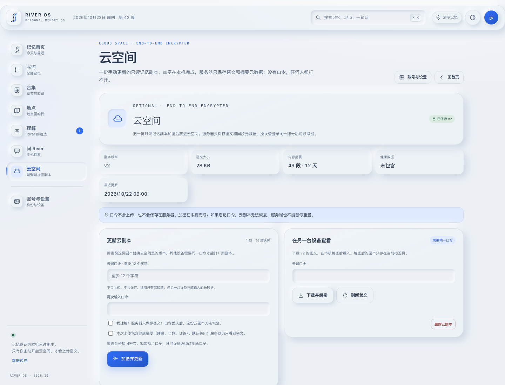
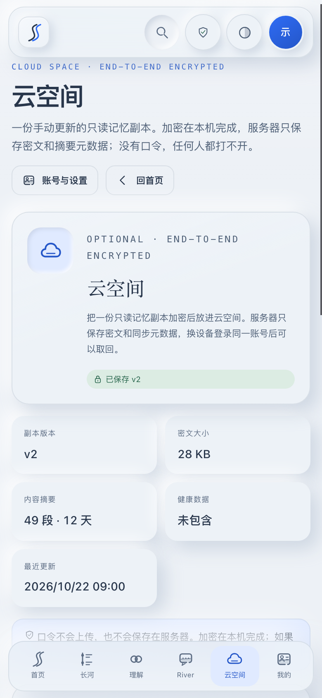

# 云空间原生互通验收 · 2026-10-22

状态：**代码与本地/隔离环境验收通过；尚未部署到生产，尚未用真实账号完成 Mac/iPhone 生产旅程。** 本报告只把实际跑过的命令和输出算作证据；编译通过不等于 UI 旅程通过，服务端集成测试也不等于真机验收。上一轮 Web 云空间的部署与浏览器验收见 [USER_MEMORY_CLOUD_2026-10-20](USER_MEMORY_CLOUD_2026-10-20.md)。

本轮对应 v5.1 §2.3 / T45 新增范围：独立「云空间」页、macOS/iOS 最小入口（导出→加密→上传；下载→解密→只读预览）、健康数据单独同意、双设备密文往返与 DB 只见密文。

## 1. 本轮改动

| 层 | 改动 | 边界 |
|---|---|---|
| Web 控制台 | `#/cloud` 成为独立空间；左侧导航、移动端底栏、命令面板和路由都直接进入；上传/下载/删除/元数据复用原云空间表单与外观 | 不新建站点，不写营销页；账号页不再承载独立入口，旧 `#/account/cloud` 重定向到 `#/cloud` |
| Web 加密 | `cloud-core.js` 增加健康段落过滤：`health` / `workout` / `stateOfMind` 默认在加密前剔除；`summary.includes_health` 由客户端声明 | 服务器无法验证该布尔值；它只是同意元数据，不是内容保证 |
| Web 健康同意 | 健康勾选默认不选中；勾选后提交时再弹一次确认，取消则不上传 | 撤回方式是关闭勾选再上传新版本，旧密文需被替换或删除 |
| macOS | 设置新增「云空间」分类与页面：登录状态、元数据、口令确认、上传/更新、删除、下载解密后的只读预览 | 只读预览，不写回本机日记；Mac 无 HealthKit，上传前剔除从 iPhone 同步来的健康段落 |
| iOS | 「导出我的记录」旁新增「云空间」入口：导出→加密→上传；下载→解密→只读预览；健康摘要单独开关 + 二次确认 | 健康默认关闭；不上传 HealthKit 原库；不自动同步 |
| Core | 新增 `CloudMirror.swift`：信封/摘要模型、PBKDF2-SHA-256 + AES-GCM-256、8 MB 客户端上限、旧信封缺少 `includes_health` 时按未声明处理 | 口令 12–128 字符；默认 600,000 次迭代；口令和明文不落盘 |
| Server | `summary` 白名单增加 `includes_health`，仍用 `DisallowUnknownFields` 拒绝其他夹带字段 | 只存密文、KDF 参数、IV、大小与白名单摘要；不存口令/明文 |
| 门禁脚本 | iOS 编译使用一次性 HOME、独立 SwiftPM 包缓存，并关闭 manifest/前端嵌套 sandbox；D 阶段仍只编译 test target，不运行 iOS 单测 | 不改变 D 阶段豁免口径；T23 仍欠账 |

## 2. 加密与数据边界（本轮实测口径）

- 信封：`river.cloud-mirror` v1；KDF：PBKDF2-SHA-256；cipher：AES-GCM-256；AAD：`river.cloud-mirror:v1`。
- 明文：`river.memory-mirror` v2（`format/version/exported_at/persona/entries/contexts/collections/understandings`）。
- 客户端密文上限 8 MiB，服务端 16 MiB；口令 12–128 个字符。
- 健康段落只在本次上传明确同意时进入明文；未同意时在加密前删除，且 `includes_health` 为 false 或缺失。
- 服务端只能看到：密文、盐、迭代次数、IV、格式版本、密文大小、修订号、时间、段数/天数/地点/合集/理解数/首末日期、客户端声明的 `includes_health`。
- 服务端看不到：口令、明文正文、位置文本、健康原库、AI 对话、复制密钥。口令丢失不可恢复。

## 3. 自动化证据

### 3.1 Web / Node

```sh
cd website/user
node --test tests/*.test.mjs
```

结果：**41 项通过，0 失败，0 跳过**（约 143 ms）。覆盖：

- Web 加密/解密往返、密文不含明文、错误口令、篡改密文、口令策略、Base64 分块；
- `river.memory-mirror` v2 的 `contexts` 往返；
- 健康段落在默认上传中被删除，只有 `includeHealth: true` 才保留；
- **Swift 生成的信封能被 Web 解密**（`Fixtures/swift-cloud-envelope.json`，错误口令被拒）；
- 独立云空间路由、上传/下载表单、健康勾选默认不选中、健康二次确认文案。

结构测试同时断言健康勾选没有 `checked` 属性，防止后续把默认关改成默认开。

### 3.2 Swift Core / 原生加密

```sh
source scripts/select_xcode.sh
swift test --disable-sandbox --package-path Packages/RiverDiaryCore
```

结果：**98 个测试、9 个 suite 全部通过**（约 0.1 s）。覆盖：

- 信封往返与摘要计数、密文不含明文；
- 错误口令、篡改密文 fail-closed；
- 健康段落默认剔除、明确同意后保留；
- 口令长度策略；
- **Web 生成的信封能被 Swift 解密**（`Fixtures/web-cloud-envelope.json`）；
- 旧信封没有 `includes_health` 时按 false 解码，不因新增字段拒绝旧密文；
- **两个干净临时目录的设备 A/B**：A 写出的信封复制到 B，B 仅凭密文和口令解密，错误口令被拒。

### 3.3 Server / 双设备与 DB

```sh
module load ... # 不需要；脚本自带隔离 PostgreSQL
./scripts/test_server_isolated.sh
```

结果：**65 个顶层测试通过，0 跳过，0 失败；含子测试共 93 个 RUN**。重点用例 `TestMemoryMirrorTwoDevicesStoreOnlyCiphertext`：

```text
=== RUN   TestMemoryMirrorTwoDevicesStoreOnlyCiphertext
SQL: SELECT count(*) ... WHERE ciphertext/summary LIKE plaintext = 0
DB row: ciphertext_bytes=152 sha256=fcf9616d162c6b0f1e3ad8245cebc04717001508e10fe8f27c41b309d91999db summary={"days": 1, "last": "2026-10-22", "first": "2026-10-22", "places": 0, "entries": 1, "collections": 0, "understandings": 0, "includes_health": true}
Device B decrypted 136 bytes with the passphrase; wrong passphrase rejected
--- PASS: TestMemoryMirrorTwoDevicesStoreOnlyCiphertext (0.09s)
PASS: all server tests ran against an isolated PostgreSQL (0 skipped).
```

该用例用两个独立登录会话（deviceA/macos、deviceB/ios）：

1. A 用 PBKDF2 + AES-GCM 在测试进程内加密，`PUT` 创建返回 201；
2. A 的 meta 返回 `"includes_health":true`，但不含密文；
3. B 用同一账号 `GET`，拿到的密文与 A 上传的逐字节相同；
4. B 用同一口令解密出 136 字节明文；错误口令无法通过 GCM 认证；
5. 直接查 `user_memory_mirrors`：`ciphertext_bytes=152`，与上传密文相同；SQL 对 ciphertext/summary 搜索明文关键词返回 **0 行**；
6. 服务端摘要只含白名单计数与 `includes_health`，没有正文/位置/健康原库。

完整日志：[server-tests.log](evidence/2026-10-22/server-tests.log)。

### 3.4 编译

```sh
# macOS
source scripts/select_xcode.sh
swift build --disable-sandbox --package-path macos/RiverDiaryMac
# Build complete! (3.64s)

# iOS app（arm64 simulator，独立 HOME 与包缓存）
xcodebuild -project ios/RiverDiary/RiverDiary.xcodeproj -scheme RiverDiary \
  -configuration Debug -destination "generic/platform=iOS Simulator" \
  -derivedDataPath ios/.simbuild ... build
# ** BUILD SUCCEEDED **

# iOS test target
xcodebuild ... -scheme RiverDiaryTests ... build-for-testing
# ** TEST BUILD SUCCEEDED **
```

日志：[mac-build.log](evidence/2026-10-22/mac-build.log)、[ios-app-build.log](evidence/2026-10-22/ios-app-build.log)、[ios-test-build.log](evidence/2026-10-22/ios-test-build.log)。

> 说明：本机 Xcode 的 SwiftPM manifest 默认写用户级缓存并调用嵌套 `sandbox-exec`，在工作区沙箱里会失败。上面用一次性 `HOME`、`-packageCachePath`、`-clonedSourcePackagesDirPath` 和 `OTHER_SWIFT_FLAGS=-disable-sandbox` 解决；不是跳过编译，也不改变产物。门禁脚本已固化同样做法。

### 3.5 浏览器布局

在 Chromium 中渲染独立 `#/cloud` 页，使用合成账号/合成副本，仅用于布局：

- 1440×1100：上传/下载/删除/元数据完整，健康勾选未选中；
- 390×844（真实设备指标模拟，不是缩放截图）：无横向溢出，六项底部导航完整；健康勾选未选中；
- 演示模式与登录后骨架都不请求真实账号，不把正文写入 localStorage。





## 4. 尚未验证 / 不能宣称

1. **未部署**：本轮没有改生产 `/var/www/flowriver`、`/opt/flowriver` 或 `/etc/flowriver`；线上 `user.flowriver.xyz` 仍是 2026-10-20 版本。独立页、健康同意和 `includes_health` 只在本地/隔离环境通过。
2. **未用真实账号**：没有在生产环境登录、上传、下载、删除或撤回健康同意；浏览器布局用合成状态。
3. **未做真机 UI 旅程**：Mac app 与 iOS app 只证明编译通过；没有在真机/模拟器里实际点击「云空间 → 输入口令 → 上传 → 另一台下载」。iOS 的 HealthKit 读取路径也没有在真机上跑过。
4. **未做 8 MiB / 16 MiB 边界压测**、PBKDF2 600,000 次在低端 iPhone 上的耗时、并发多设备真实写入、网络中断重试、浏览器配额、TOAST/备份恢复。
5. **未做辅助技术**：VoiceOver、最大辅助字号、三外观人工审计、Safari/WebKit。
6. **健康同意是客户端声明**：服务端无法验证 `includes_health` 的真假；旧密文不会因为撤回同意而自动改变，必须重新上传或删除。
7. **预览不写回**：原生端下载后只读预览，不覆盖本机日记；这是本轮的明确边界，不是“恢复写入”已完成。

## 5. 下一步（按优先级）

1. 在维护窗口部署 `website/user` 与包含 `includes_health` 白名单的 API 二进制，保留旧前端/旧二进制备份，跑匿名 401、登录后 meta、上传/下载/删除与回滚。
2. 用测试账号完成生产双设备旅程，记录请求/响应大小、DB 行与错误口令路径。
3. 在至少一台 iPhone 与一台 Mac（或干净用户目录）上实际点击原生入口，补真机截图与可访问性检查。
4. 补 8 MiB 边界与 600k 迭代耗时；再决定是否调整客户端上限或迭代次数。
